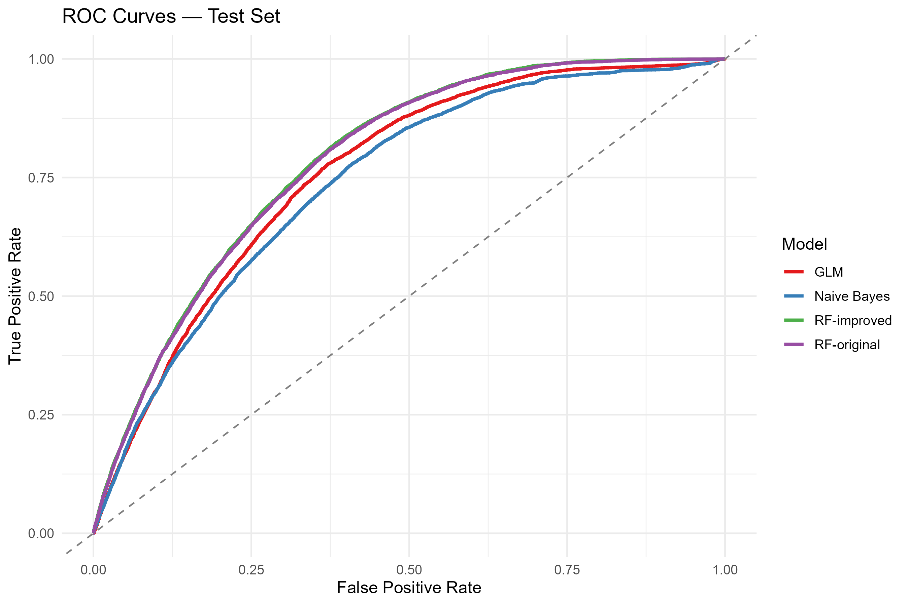
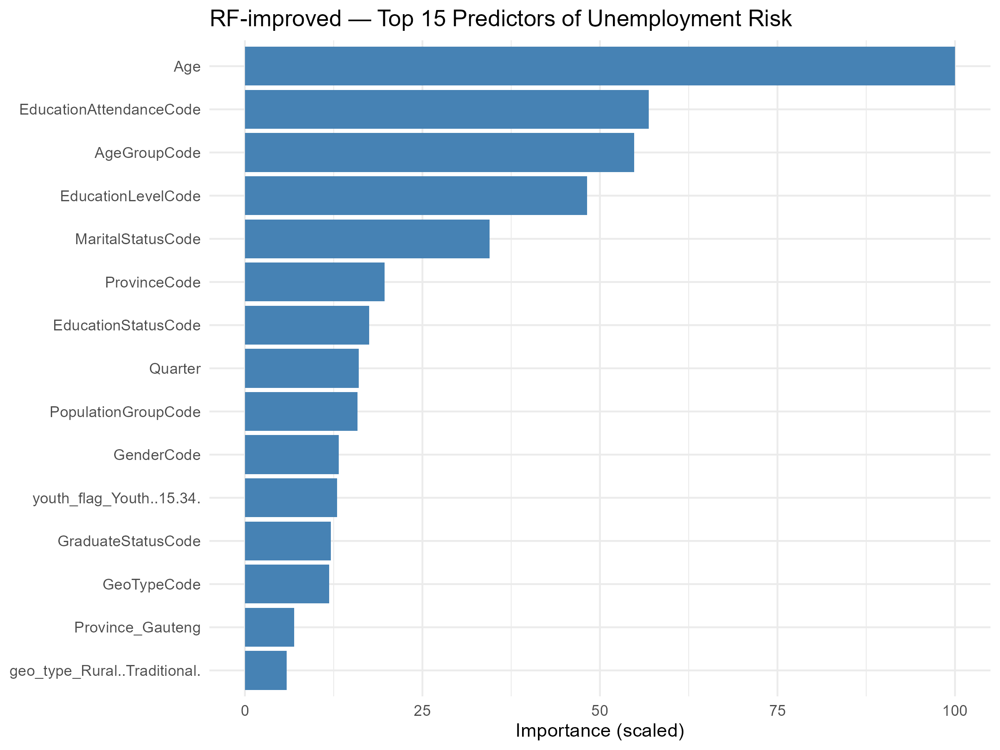
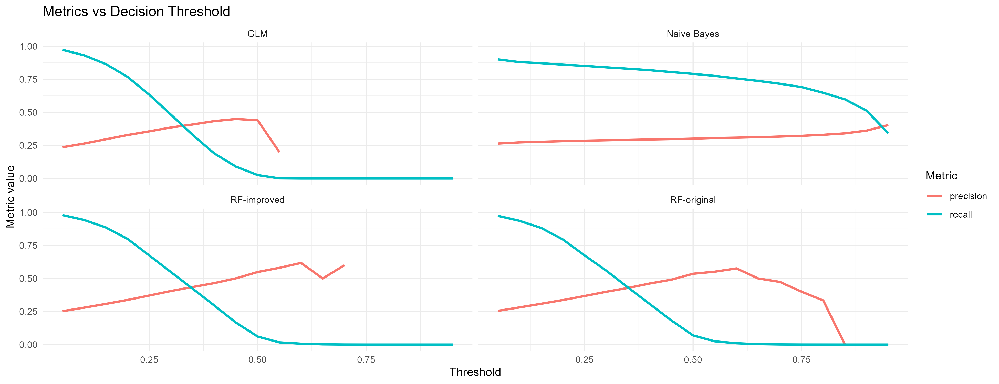
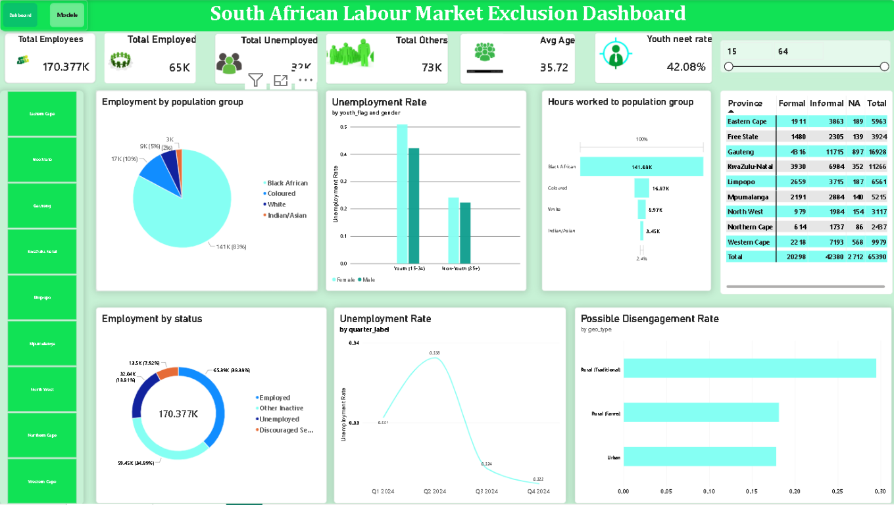

# South African Unemployment & Labour-Market Analysis

An end-to-end business intelligence project examining unemployment and labour-market exclusion in South Africa using 2024 survey extracts. This repository focuses on the final project: its business question, data preparation, model evaluation, decision-support outputs, and recommendations.

> **Important:** This is an academic portfolio project, not a tool for making decisions about individuals. The model estimates associations and does not establish causes of unemployment.

## Business question

To what extent can demographic, regional, and educational indicators help identify unemployment risk, and which indicators are most informative?

The analysis found that the available extracts do not support linking the D11 labour-market sample to the D01-D03 population, education, and economic-participation samples at person or household level. The project therefore keeps two analytical tracks separate:

- **Track A:** the D11 labour-market panel, used for the unemployment modelling work.
- **Track B:** a separate Q1 profile built by joining D01, D02, and D03 using the available person keys.

This distinction is important: the findings from these tracks must not be presented as though they describe one joined person-level dataset.

## Key result

The final evaluation reports an ROC-AUC of approximately **0.787**. At the selected random-forest threshold of **0.20**, recall is around **0.80**, with substantially lower precision (about one in three flagged cases). The threshold favours finding more positive cases at the cost of false positives; it should not be treated as a decision rule for people.

### Evaluation visuals

**Candidate-model ROC curves**



**Random-forest feature importance**



**Precision-recall trade-offs**



Additional results: [confusion matrices](results/figures/confusion-matrices.png) and [precision-recall curves](results/figures/precision-recall-curves.png).

## Final deliverables

- [Final report](reports/final-report.pdf) — full project narrative, methods, findings, limitations, and recommendations.
- [Executive presentation](reports/final-presentation.pptx).
- [Ethics and AI-use report](reports/ethics-and-ai-use.pdf).
- [Project handover and review](reports/project-handover.pdf).
- Power BI dashboard: the interactive workbook is retained locally at `dashboard/Dashboard.pbix` and excluded from Git until its embedded contents and redistribution permissions are reviewed. GitHub cannot render Power BI files, so the screenshot below gives visitors a static preview. The screenshot is not interactive; use Power BI Desktop with an authorized copy of the workbook to explore the dashboard.



*Dashboard screenshot supplied for this project. It is a static preview and does not include the interactive workbook.*

## Repository layout

```text
.
├── analysis.Rmd                  # Final end-to-end analysis
├── BI381-SDHSA.Rproj             # Open this project in RStudio
├── scripts/                      # Final model preparation and evaluation scripts
├── deployment/                   # Shiny scoring/monitoring app and smoke test
├── data/
│   ├── raw/                      # Original survey extracts (local; Git-ignored)
│   └── Cleaned/                  # Generated analytical data/model files (Git-ignored)
├── dashboard/                    # Power BI workbook (local; Git-ignored pending review)
├── reports/                      # Final report, presentation, ethics, handover
├── results/figures/               # Selected aggregate evaluation figures
├── .gitignore
└── README.md
```

## Reproducing the analysis

### Requirements

- R and RStudio
- R packages: `tidyverse`, `scales`, `knitr`, `janitor`, `caret`, `pROC`, `randomForest`, `e1071`, `gmodels`, `ranger`, `C50`, `rsample`, and `recipes`
- `rmarkdown` and a working document-rendering installation for knitting the R Markdown report

Install the packages in R:

```r
install.packages(c(
  "tidyverse", "scales", "knitr", "janitor", "caret", "pROC",
  "randomForest", "e1071", "gmodels", "ranger", "C50", "rsample",
  "recipes", "rmarkdown"
))
```

### Data and privacy

The `.gitignore` keeps the following local or generated files out of Git by default:

- `data/raw/*.csv` — source survey extracts, which may contain household/person identifiers.
- `data/Cleaned/*` — generated tables, row-level records, and serialized model/recipe objects. The `.gitkeep` placeholder is retained.
- `dashboard/*.pbix` — the Power BI workbook, which may contain embedded source data.
- `/outputs/` and deployment monitoring log/baseline files — generated evaluation or runtime data.
- RStudio state and rendered analysis artifacts such as `.RData`, `.Rhistory`, and `analysis.docx`.

The four source CSVs are kept locally in `data/raw/` so the analysis can be reproduced. Publish them only if the dataset's licence and privacy requirements explicitly permit redistribution. Otherwise, an authorized reviewer must obtain them through the approved data-access route and place them in `data/raw/`:

- `D01_Population_Profile.csv`
- `D02_Learning_Profile.csv`
- `D03_Economic_Participation.csv`
- `D11_Labour_Market.csv`

The cleaned analytical tables, R model objects, and the person-level CSV associated with the dashboard are also excluded. Do not force-add these files to a public repository without the necessary authorization.

These ignore rules are not a complete privacy or licensing review: reports, presentations, screenshots, and other tracked files must still be checked for personal information, restricted data, and redistribution rights before publishing. Also, `.gitignore` does not remove a file that has already been committed or staged.

### Run

Open `BI381-SDHSA.Rproj` in RStudio and set the working directory to the project root.

1. Confirm that all four source CSVs are in `data/raw/`.
2. Knit `analysis.Rmd`. It performs the descriptive/data-quality work, builds the two analytical tracks, and writes generated inputs under `data/Cleaned/`.
3. From the project root, run the modelling scripts in order:

   ```r
   source("scripts/02b_fix_baked.R")
   source("scripts/03_evaluation.R")
   source("scripts/03c_finalise.R")
   ```

4. `scripts/03b_rf_balanced.R` is an alternative-model evaluation, not a required step in the selected-model workflow.

The workflow uses a stratified 70/30 split and five-fold cross-validation. Seeds are set, but results may still vary with R/package versions and system configuration. Generated outputs are local and ignored by Git.

## Deployment status

The Shiny scoring and monitoring app is in `deployment/`. Run the analysis and modelling workflow above first to generate its required local model artefacts, then follow [the deployment README](deployment/README.md). The author reports running the prototype locally; it could not be independently run in this environment because R is unavailable.

## Limitations and responsible use

- Results describe patterns in the supplied survey data, not causal effects.
- A 0.20 threshold increases recall but also generates many false positives.
- Subgroup performance is uneven; metrics should be reviewed alongside subgroup sample sizes.
- Scores must not be used as automated eligibility, hiring, or service-allocation decisions.
- Survey design, data access, model drift, calibration, and external validation limit interpretation and future use.
